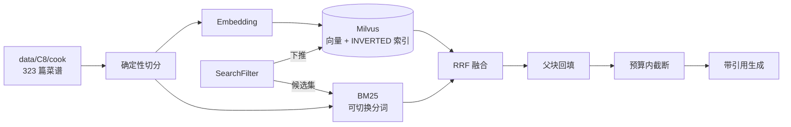

# recipe-agentic-rag

把 [all-in-rag](https://github.com/datawhalechina/all-in-rag) 第 8 章（C8）的食谱 RAG 重写成**可消融的检索底座**，再在其上叠一层带检索规划与工具调用的 Agentic RAG。

底座沿用 C8 的父子块 + 混合检索；新增的是确定性索引、可下推的过滤、可切换的检索臂、离线评估与 trace。

## 为什么不是再跑一遍 C8

C8 串通了流程，但有几处会直接毁掉实验结论的地方（逐条对应 `code/C8/` 源码）：

| 问题 | 位置 | 处理 |
|---|---|---|
| `rglob("*.md")` 把投稿模板 `template/示例菜` 当菜谱入库 | `data_preparation.py:59` | `exclude_dirs` 排除 |
| `child_id = uuid4()`，两次建库 ID 全变，qrels 无法锚定 | `data_preparation.py:200` | `md5(父ID + 章节路径 + 序号)` |
| 只存 `difficulty='★★★'`，无法范围过滤 | `data_preparation.py:117` | 另存 `difficulty_level: int` |
| 先取 `top_k*3` 再后置过滤，条件越严召回越漏 | `retrieval_optimization.py` | 过滤下推（Milvus `filter=` / 本地掩码） |
| RRF 用 `md5(page_content)` 做身份，同名小节会被合并 | `retrieval_optimization.py` | 按 `chunk_id` 融合 |
| 分数写回共享 `Document.metadata`，跨查询污染 | `retrieval_optimization.py` | 分数只存在于返回对象 |
| 按字符 `break` 整篇丢弃父文档，抵消父子块收益 | `generation_integration.py` | token 预算内文档级截断 |

还有一处影响最大的：`BM25Retriever` 用 langchain 默认的 `text.split()` 分词，中文菜谱没有空格，**稀疏路等于失效**。本仓库把分词做成三臂（`char_bigram` / `jieba` / `whitespace`=上游行为），单独隔离这个变量。

## 架构



`rag_core/` 不知道 Agent 存在；`agent/` 只经 `tools/` 的 JSON Schema 调用它；`eval/` 只读 trace。三层解耦，换编排框架不影响消融结论。

## 快速开始

```bash
python scripts/fetch_data.py                            # 拉 323 篇菜谱到 data/C8/cook

docker compose -f docker-compose.milvus.yml up -d       # milvus v2.5.14
curl -f http://localhost:9091/healthz

pip install -r requirements.txt
cp .env.example .env        # 填 LLM_API_KEY / EMBEDDING_API_KEY

python -m rag_core.cli build  --config configs/base.yaml
python -m rag_core.cli search "简单的素菜，10 分钟能做好" --max-difficulty 2
python -m rag_core.cli search "红烧肉要炖多久" --arms sparse   # 只跑稀疏臂
python -m rag_core.cli ask    "红烧肉要炖多久" --json

python scripts/selfcheck.py --config configs/base.yaml  # 五项自检 + 落盘报告
```

无 GPU：`embedding.provider` 换 `openai_compatible`；无 Docker：`store.backend` 换 `local`。
逐步验收与排错见 [`docs/02-runbook.md`](docs/02-runbook.md)。

### 自检输出（本地 hashing 向量，只验证机制）

| 检查 | 结果 |
|---|---|
| 索引确定性 | 两次切块 `chunk_id` / `parent_id` 逐条一致，1701 块无重复 |
| 排除目录 | `template/示例菜` 未入索引（323 篇 → 322 篇） |
| 分词（gold=菜名） | `char_bigram` 命中 92% Hit@1；`whitespace`（上游）0% |
| 过滤下推 | `pre` 合规率 100% / 平均候选 164；`post` 合规率 40% / 候选 1701 |

dense 臂数字要在服务器上换真 embedding 才有意义，届时替换上表。

## 目录

```
rag_core/       检索底座（14 模块）：切分 / 索引 / 双路召回 / RRF / 上下文 / 生成
agent/          P2：LangGraph 状态机（understand → plan → act → reflect）
tools/          P2：检索能力的 function calling schema
eval/           P1：评测集、指标、消融脚本
scripts/        取语料（fetch_data.py）与自检（selfcheck.py）
configs/        一份 YAML = 一次实验
docs/           01-design 设计说明 · 02-runbook 服务器跑通手册
```

`agent/`、`tools/`、`eval/` 目前只有设计说明，代码在 P1/P2 落地。

## 消融矩阵

| 组 | 变量 | 臂 |
|---|---|---|
| A | 分词器 | `whitespace`（上游）/ `char_bigram` / `jieba` |
| B | 检索臂 | `dense` / `sparse` / 双路 |
| C | 过滤时机 | `pre`（下推）/ `post`（上游） |
| D | 父块排序 | `hit_count`（上游）/ `rrf_sum` / `max_score` |
| E | RRF 常数 | 10 / 30 / 60 / 100 |
| F | 上下文策略 | 整篇 break / 文档级截断 |

指标：Recall@k、MRR、nDCG@10、候选存活率、Faithfulness、Citation Precision，附 tokens/query 与 p50/p95 延迟。口径见 [`eval/README.md`](eval/README.md)。

## 路线图

| 阶段 | 内容 | 状态 |
|---|---|---|
| P0 | 检索底座重构、确定性 ID、过滤下推、可切换臂、CLI | ✅ |
| P1 | 评测集（100 条）+ 指标脚本 + 六组消融报告 | ⬜ |
| P2 | LangGraph 状态机、检索工具化、反思与重试 | ⬜ |
| P3 | 自适应检索深度（按查询类型定 k） | ⬜ |
| P4 | 重排序 + 父子块粒度对比 | ⬜ |
| P5 | trace 与 badcase 归因 | ⬜ |

## 范围

不做多模态菜谱图、不做 GraphRAG（C9 已有）、不做 Web 产品——都会稀释"算法实验"这条主线。

语料与原始实现来自 [datawhalechina/all-in-rag](https://github.com/datawhalechina/all-in-rag)（MIT）。缺陷记录均为阅读源码所得。
