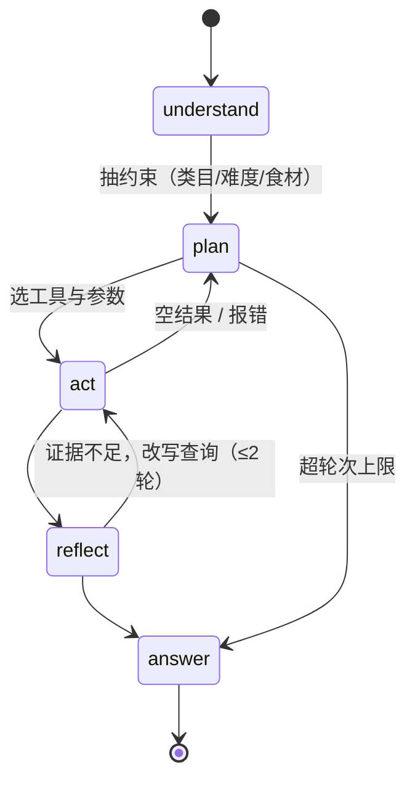

# agent/（P2）

只做流程控制：不检索、不切分、不碰 Milvus。能力全部经 `tools/` 的 JSON Schema 调用，
换编排框架时检索层一行不改（见 `docs/01-design.md` §5）。

## 与上游 C7 的关系

`code/C7/agentic_rag/agent.py` 已有 LangGraph 版同类结构，本层沿用，修三处：

| C7 问题 | 后果 | 做法 |
|---|---|---|
| `_analyze_query` 的 `sub_queries` 从未被执行 | 拆解查询是假动作 | `plan` 输出必须被 `act` 消费，否则删掉该边 |
| 去重用 `str(hash(...))` | `PYTHONHASHSEED` 盐化，跨进程不可复现 | 按 `chunk_id` |
| `critique` 的输入是整段工具输出字符串 | 反思对象是日志不是证据 | 只看结构化证据（菜名 / 章节 / 分数 / 约束满足） |

## 不变量

1. `attempts <= 2`，超限直接出答案并标 `degraded=True`；
2. 每次运行记 `tokens / 工具调用次数 / 延迟`，与基线同表；
3. 同 `query + config` 两次运行，工具调用序列一致（温度 0.1，允许文本差异）。
