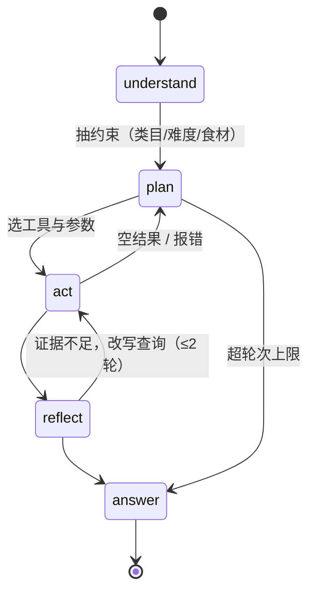

# 设计

只讲本仓库自己的设计。与原项目的逐条差异见 [`01-vs-c8.md`](01-vs-c8.md)，跑通与排错见 [`03-runbook.md`](03-runbook.md)。

## 1. 分层

```
rag_core/   检索底座：不知道 Agent 存在，不 import 任何编排框架
tools/      P2：把 rag_core 包成 function calling 工具（JSON Schema）
agent/      P2：LangGraph 状态机，只经 tools/ 触达检索
eval/       P1：只读 trace，不改检索
```

三层解耦的目的只有一个：**换编排框架时，历史消融实验仍然可比**。

## 2. rag_core 模块

| 模块 | 职责 | 关键约定 |
|---|---|---|
| `schema.py` | 数据契约（`Recipe` / `Chunk` / `SearchFilter` / `ScoredChunk` / `ParentHit` / `RetrievalResult`） | 全仓库唯一契约，索引层、Milvus schema、评测集共用 |
| `text.py` | 分词三臂 + token 估算 + 预算内截断 | `whitespace` 臂专门复现上游行为，用于消融 |
| `bm25.py` | 倒排索引 + BM25 打分 | `search(..., allowed_ids=)` 支持候选子集内检索 |
| `markdown_splitter.py` | 按 `#/##/###` 切章节 | 代码围栏内不识别标题；剥离 `<!-- -->` |
| `data_preparation.py` | 语料加载、元数据增强、父子块构建、父块排序 | ID 全确定性；`rank_parents` 三策略可切 |
| `embeddings.py` | 三种 embedding 后端 | `sentence_transformers` / `openai_compatible` / `hashing`(冒烟) |
| `vector_store.py` | 向量后端（`MilvusVectorStore` / `LocalVectorStore`） | 同一接口 + 同一 `SearchFilter`，差异只在"谁执行过滤" |
| `retrieval.py` | 双路召回 + RRF 融合 + 父块回填 + trace | 融合身份是 `chunk_id`；分数只存在于返回对象 |
| `context.py` | 上下文组装 | 文档级截断，不整篇丢弃 |
| `llm.py` | Chat 客户端 | 任意 OpenAI 兼容端点，重试与 usage 记录 |
| `generation.py` | 提示词 + 引用标注 + `citation_precision` | 只用参考菜谱、标 `[n]`、没写就说未提及 |
| `config.py` | YAML → dataclass，`${ENV}` 展开 | 未知键直接报错，配置写错不静默 |
| `pipeline.py` | 组装：切块 → 向量化 → 建库 → BM25 → 检索器 | `RecipeRAG.build / load_local / retrieve / ask` |
| `cli.py` | `build` / `search` / `ask` / `stats` | 每个实验都能用命令行复现 |

## 3. 数据契约

| 字段 | 类型 | 用途 |
|---|---|---|
| `chunk_id` | md5(32) | 主键、融合键、qrels 锚点 |
| `parent_id` | md5(32) | 父块回填、标量索引 |
| `dish_name` | str | 菜名精确匹配 |
| `category` / `category_key` | str | 中文展示 / ASCII 过滤（避开中文表达式转义） |
| `difficulty` / `difficulty_level` | str / int8 | 展示 / 范围过滤 |
| `section` / `section_path` | str | 章节类型，P3 分通道召回用 |
| `source_rel` | str | 回原文 |
| `text` | str | 向量化与 BM25 输入 |

## 4. 接口承诺（P2 之后不改）

```python
RecipeRAG.retrieve(query, flt=None, top_k=None, arms=None) -> RetrievalResult
RecipeRAG.ask(query, flt=None, top_k=None) -> (Answer, RetrievalResult)
RetrievalResult.to_trace() -> dict   # 落盘，供 eval 与 Agent trace 复用
```

Agent 层只能经这些入口触达检索。

## 5. 工具层（P2）

每个工具只做一件事，返回**结构化证据**而不是拼好的文本——上游 C7 的 `tools.py` 返回 Markdown 字符串，导致反思节点只能对整段文字瞎猜。

| 工具 | 参数 | 用途 |
|---|---|---|
| `search_recipes` | `query`, `top_k=5`, `filters?` | 主检索（双路 + RRF） |
| `filter_by_constraints` | `filters` | 只筛条件、返回候选规模，让 Agent 学会"先缩小空间再检索" |
| `get_recipe_detail` | `dish_name`, `section?` | 取整篇或指定章节（原料 / 操作） |
| `compare_recipes` | `dishes[]` | 多菜对比（难度、原料差异） |

四条约束：

1. **只读 + 幂等**，便于重放评测；
2. 返回带 `score` 与来源臂，让反思节点能区分"召回了但分低"和"根本没召回"；
3. **空结果不是异常**：`{"hits": [], "reason": "no_candidate_after_filter"}`；
4. 参数在工具内校验，类目非法返回 `{"error": "unknown_category", "allowed": [...]}`，让模型自己纠错。

## 6. Agent 状态机（P2）



三条不变量：

1. `attempts <= 2`，超限直接出答案并标 `degraded=True`；
2. 每次运行记 `tokens / 工具调用次数 / 延迟`，与基线同表；
3. 同 `query + config` 两次运行，工具调用序列一致（温度 0.1，允许文本差异）。

## 7. 评估协议（P1）

以菜名为相关性单位，gold 只标到菜名，不标 chunk（避免脆弱锚点）。先做 100 条，宁少不脏。

| 类型 | 条数 | 例子 | 考什么 |
|---|---|---|---|
| 单跳事实 | 35 | 红烧肉要炖多久 | 基础召回 |
| 约束组合 | 25 | 10 分钟内能做好的简单素菜 | 过滤下推 |
| 多食材 | 20 | 有五花肉和豆瓣酱能做什么 | 稀疏路 + 实体匹配 |
| 对比 / 多跳 | 10 | 红烧肉和东坡肉的区别 | Agent 多步 |
| 该拒答 | 10 | 怎么做分子料理球化 | 防编造 |

留 15 条作 dev（调参用），不进报告。

```
Recall@k     = |gold ∩ topk| / |gold|
MRR          = 1 / rank_first_relevant
nDCG@10      = 分级相关性（2=gold，1=同类同食材，0=无关）
候选存活率   = 过滤后候选块数 / 全库块数     # 解释过滤造成的召回损失
Faithfulness / Answer Relevancy              # llamaindex 口径 + 100 条人工抽检校准
Citation Precision                           # 引用的 [n] 是否落在真实来源内
tokens/query、p50/p95 延迟、工具调用次数      # 代价面，与收益同表
```

消融协议：每次只动一个变量，其余固定 `configs/base.yaml`；每个配置跑 3 次取中位数；一个配置 = 一个 `configs/ablation/<name>.yaml`，产物落 `artifacts/<name>/`。六组变量见 README 的消融矩阵。

报告固定四段，不许只报涨的部分：配置 × 指标表（含 bootstrap 95% 置信区间）→ 代价行 → badcase 归类 → 结论与不确定性（"100 条下该差异不显著"要写明）。

badcase 归因：每条 trace 带 `filter / candidates / dense_hits / sparse_hits / fused / parents`。先看 `candidates`——为 0 说明约束过严或解析错，不是排序问题；`dense_hits=0` 说明语义空间没覆盖；两路都有命中但排序错，才是融合或重排的锅。

## 8. 已知未做

- `embed_query_prefix`（bge 查询指令）默认留空，未验证增益；
- RRF 常数 k 只做了配置化，未扫参（P1）；
- 父块回填固定 `parent_top_n=2`，未按块覆盖度动态决定；
- embedding 模型横向对比与重排序一并在 P4 做；
- 同名菜谱 `陈皮排骨汤` 在语料里有两份，评测集须按 `parent_id` 去重（见 [`data/README.md`](../data/README.md)）。
